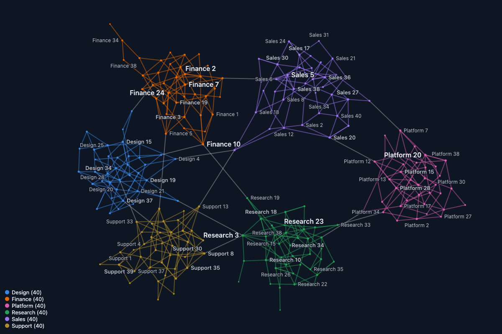

# VivaGraph

[](https://github.com/anvaka/VivaGraphJS/actions/workflows/tests.yaml)

Draws graphs in the browser. One call gives you a force layout, WebGL drawing, labels, and
mouse, touch and keyboard interaction:

``` js
const graph = Viva.createGraph();
graph.addLink('Alice', 'Bob');
graph.addLink('Bob', 'Carol');

Viva.render(graph);
```



> **Version 1.0 is a rewrite and is not on npm yet.** `npm install vivagraphjs` still installs
> 0.12. The 0.x library (SVG and WebGL renderers, `Viva.Graph.View.renderer`) lives on the
> [`0.x` branch](https://github.com/anvaka/VivaGraphJS/tree/0.x) and stays on npm as
> `vivagraphjs@0`. See [Coming from 0.x](#coming-from-0x).

## What you get

VivaGraph 1.0 is a small front door to [ngraph.forcelayout](https://github.com/anvaka/ngraph.forcelayout)
and the modules that live next to it. `render()` makes the choices their
[demo](https://anvaka.github.io/ngraph.forcelayout/) makes:

* **A layout that starts close to done.** Nodes start where graph distances put them (pivot MDS
  or a radial tree), so the force layout polishes rather than untangles.
* **WebGPU for big graphs.** From 2,000 nodes up the layout runs on the GPU when the device has a
  real one, and on the CPU otherwise. Nothing to configure, and no error when it is missing.
* **Drawing that stays cheap.** WebGL, positions in a texture, a frame only when something
  changed. The view is built for hundreds of thousands of nodes.
* **It stops when it is done.** The layout runs as many steps as a frame can carry, stops once
  the drawing has settled, and wakes when the graph changes or a node is dragged.
* **Labels that don't pile up.** The most connected nodes are named first, and zooming in makes
  room for more.
* **Interaction out of the box.** Hover, drag, select, tooltips, search (`/`), and keyboard and
  screen-reader navigation (Enter, arrows, `?` lists the keys). Mouse, pen and touch follow the
  same rules.
* **Any number of dimensions.** `layout: {dimensions: 3}` gives a 3D drawing you can turn.

## Install

With a script tag (the global is `Viva`):

``` html
<script src="https://unpkg.com/vivagraphjs@1/dist/vivagraph.min.js"></script>
```

With a bundler:

``` sh
npm install vivagraphjs
```

``` js
import {render, createGraph} from 'vivagraphjs';
```

Until 1.0 is published, build it from this repository: `npm install && npm run build` writes
`dist/vivagraph.js`, `dist/vivagraph.min.js` (script tag) and `dist/vivagraph.module.js`
(ES module). The [examples](examples) use that build.

## Usage

``` js
const viva = Viva.render(graph);                    // fills the window
const viva = Viva.render(graph, element);           // fills your element (give it a size)
const viva = Viva.render(graph, element, options);
const viva = Viva.render(graph, options);           // options.container, or the window
```

`graph` is an [ngraph.graph](https://github.com/anvaka/ngraph.graph); `Viva.createGraph()` makes
one. Change it at any time (`addNode`, `addLink`, `removeNode`, ...) and the drawing follows.

`element` can also be a `<canvas>` of your own. Otherwise `render()` adds a canvas as the first
child of the element, so what the element already holds (a legend, a toolbar) stays on top.

### Options

| Option | Default | What it does |
|---|---|---|
| `layout` | `{}` | Settings for the layout: `springLength`, `springCoefficient`, `gravity`, `dimensions` and the rest of [ngraph.forcelayout's](https://github.com/anvaka/ngraph.forcelayout#physics-simulator). Or a function `graph => layout` that builds the layout yourself. |
| `start` | `'pivot'` | Where nodes start. `'pivot'`: where graph distances put them. `'random'`: next to their neighbours, as the layout itself places them; use it for graphs that grow one node at a time. |
| `gpu` | `'auto'` | `'auto'`: WebGPU for graphs of 2,000 nodes and more, when there is a hardware adapter. `true`: at any size. `false`: always the CPU. |
| `stepsPerFrame` | `0` | Layout steps per frame. `0` fits as many as `frameBudget` allows, from 1 to 10. |
| `frameBudget` | 8, or 4 on phones and tablets | Milliseconds of layout work per frame when `stepsPerFrame` is 0. |
| `autoStop` | `true` | Stop stepping once the layout has settled. |
| `run` | `true` | Start running at once. `false`: call `viva.resume()` yourself. |
| `background` | `'#0e1624'` | Canvas color. The default colors are made for a dark background. |
| `style` | `{}` | How nodes and links look: `colorBy`, `palette`, `color`, `linkColors`, `minSize` and the rest of the view's [style module](https://github.com/anvaka/ngraph.forcelayout/tree/main/modules/view#style). `false`: leave colors and sizes to the `view` options. |
| `labels` | `'auto'` | `'auto'`: labels when nodes have names (`data.label`, `data.name`, or ids that are words). `true`: always. `false`: never. An object: options of the [labels module](https://github.com/anvaka/ngraph.forcelayout/tree/main/modules/view#labels), such as `{importance: 'pagerank'}`. |
| `interactive` | `true` | Hover, drag, select, tooltips, keyboard navigation and search. `false` leaves only the camera. |
| `fit` | `true` | Keep the whole drawing in view until the user moves the camera (the `0` key brings it back). An object: options of the [fit module](https://github.com/anvaka/ngraph.forcelayout/tree/main/modules/view#fit). |
| `view` | `{}` | More options for the [view](https://github.com/anvaka/ngraph.forcelayout/tree/main/modules/view#usage) itself: `nodeColor`, `linkColor`, `nodeLabel`, `camera`, `reach`, ... |

### What render() returns

| | |
|---|---|
| `viva.graph`, `viva.layout`, `viva.view`, `viva.scene`, `viva.canvas` | The parts. `layout` is the one that runs now; `restart()` makes a new one. |
| `viva.ready` | A promise of `'webgpu'` or `'cpu'`: where the layout runs. Drawing doesn't wait for it. |
| `viva.pause()`, `viva.resume()`, `viva.isRunning()` | Stop and run the layout. A paused drawing still pans and zooms, and nodes can still be dragged. |
| `viva.restart()` | A fresh layout of the same graph with the same settings. Returns a promise. |
| `viva.fit()` | Bring the whole drawing back into view. |
| `viva.stats()` | `{backend, gpuReason, running, settled, steps, msPerStep, stepsPerFrame, nodes, links}`. `gpuReason` says why a layout that asked for WebGPU runs on the CPU. |
| `viva.on(name, fn)`, `viva.off(name, fn)` | `'settled'` (`{step, reason}`) when the layout has settled, `'wake'` when it moves again. |
| `viva.setStepsPerFrame(n)` | Change `stepsPerFrame`. |
| `viva.dispose()` | Stop, free the GPU resources, and remove the canvas if `render()` made it. |

## Recipes

**Colors from the data.** Name a field of the nodes' data. The biggest categories take the
palette's eight colors in order; links inside a category take its color.

``` js
graph.addNode('Ada', {team: 'Research'});
const viva = Viva.render(graph, {style: {colorBy: 'team'}});
viva.view.getModule('style').legend();   // {title, items: [{color, label, count}], more}
```

**Reacting to the user.** The view reports taps, hovers, drags and selection changes, each with
the node under the pointer:

``` js
viva.view.on('tap', e => { if (e.node) console.log(e.node.id, e.node.data); });
viva.view.on('select', e => console.log(e.nodes.map(node => node.id)));
```

The full list is in the view's [events](https://github.com/anvaka/ngraph.forcelayout/tree/main/modules/view#events).

**Tuning the physics.** Pass settings at the start, or change them while it runs:

``` js
const viva = Viva.render(graph, {layout: {springLength: 30, gravity: -20}});
viva.layout.simulator.springLength(50);   // the settled layout wakes and settles again
```

**Your own layout.** Give `layout` a function, and add whatever
[ngraph.forcelayout](https://github.com/anvaka/ngraph.forcelayout#changing-the-physics) takes:
stages, formulas, another repulsion law.

``` js
Viva.render(graph, {
  layout: graph => Viva.createLayout(graph, {repulsionLaw: 'exp(-r / 50) / r^2'})
});
```

**Pinning a node.**

``` js
viva.layout.pinNode(graph.getNode('Ada'), true);
viva.layout.setNodePosition('Ada', 0, 0);
viva.view.invalidate();   // positions changed outside of a layout step
```

**Putting the parts together yourself.** `createLayout`, `createScene`, `createView`,
`placeNodes` and the view's modules (`styleNodes`, `fitLayout`, `labelNodes`, `hoverNodes`,
`dragNodes`, `selectNodes`, `inspectNodes`, `navigateNodes`, `searchNodes`, `pulseNodes`) are
exported. [src/render.js](src/render.js) is a few hundred lines that show how they fit.

## Examples

In [examples](examples), each a script tag and a few lines:

* [hello.html](examples/hello.html): four nodes, one call.
* [groups.html](examples/groups.html): colors from the data, with a legend.
* [big.html](examples/big.html): 20,000 nodes, on WebGPU where the device has one.
* [3d.html](examples/3d.html): a cube of 1,728 nodes in 3D.
* [dynamic.html](examples/dynamic.html): tap a node to grow the graph.

## Browser support

WebGL 1 with float textures and instancing, which every current browser has. WebGPU is used only
where it is available. `render()` throws an error that names what is missing when WebGL can't
draw the view.

## Coming from 0.x

1.0 shares the name and the goal with 0.x, not the code or the API.

| 0.x | 1.0 |
|---|---|
| `Viva.Graph.graph()` | `Viva.createGraph()`: the same ngraph.graph, a current version |
| `Viva.Graph.View.renderer(graph, {container}).run()` | `Viva.render(graph, container)` |
| `renderer.pause()`, `renderer.resume()`, `renderer.dispose()` | `viva.pause()`, `viva.resume()`, `viva.dispose()` |
| `Viva.Graph.Layout.forceDirected(graph, {springLength, ...})` | `render(graph, {layout: {springLength, ...}})`; `springCoeff` and `dragCoeff` are now `springCoefficient` and `dragCoefficient` |
| `layout.pinNode()`, `layout.setNodePosition()` | the same, on `viva.layout` |
| `graphics.node(...)` / `graphics.link(...)` with SVG elements | not there: nodes are discs and links are lines, colored and sized from the data (`style`), with labels and tooltips |
| `Viva.Graph.View.webglGraphics()` and its custom shaders | not there: `render()` always draws with WebGL |
| `Viva.Graph.Layout.constant` | not there |
| `Viva.Graph.centrality`, `Viva.Graph.generator`, `Viva.Graph.serializer` | use [ngraph.centrality](https://github.com/anvaka/ngraph.centrality), [ngraph.generators](https://github.com/anvaka/ngraph.generators), [ngraph.fromjson](https://github.com/anvaka/ngraph.fromjson) |

If your page draws nodes as custom SVG or images, stay on `vivagraphjs@0` for now.

## Development

``` sh
npm install
npm run build          # dist/
npm test               # unit tests (Node)
npm run test:browser   # the built library in headless Chrome (CHROME_PATH picks the browser)
npm start              # rebuild on change
```

The layout, the view, the WebGPU runner and the pivot start are developed in the
[ngraph.forcelayout](https://github.com/anvaka/ngraph.forcelayout) repository. Its add-on
modules are not on npm yet, so `package.json` installs that repository at a pinned commit and
[src/deps.js](src/deps.js) reaches into it. Everything is bundled into `dist/`, so the published
package has no dependencies. To work against a local checkout, `npm link` it:

``` sh
npm link ../ngraph.forcelayout
```

## License

BSD 3-Clause. See [LICENSE](LICENSE).

Looking for other graph drawing libraries? [Here is a list](http://anvaka.github.io/graph-drawing-libraries/#/all).
